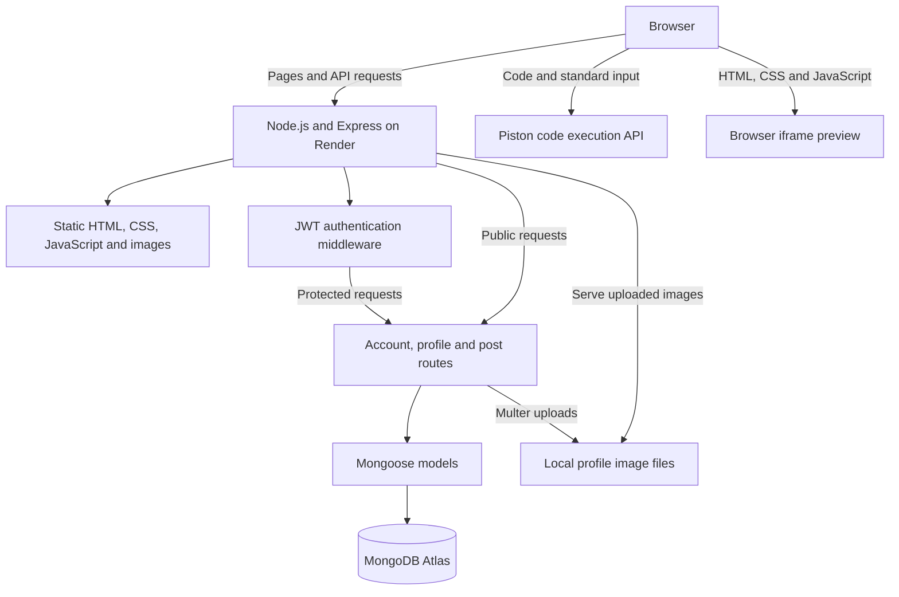

# ZCoder

ZCoder is a coding practice and community web application. Users can run code, solve practice problems, create accounts, publish community posts, and update their profiles.

## Architecture

One Node.js application serves the frontend pages and the Express API. The frontend uses HTML, CSS, and JavaScript, with page styles and behavior largely defined inside the HTML files. Mongoose connects the API to MongoDB. The deployment discussed for this project uses Render for application hosting and MongoDB Atlas for the database.



The server loads configuration, registers static files and API routes, and connects to MongoDB. After the database connection succeeds, it listens on `0.0.0.0` using `PORT`, with a default of `5000`. Missing database configuration or a failed connection causes startup to exit with an error.

## Services and libraries

| Component | Purpose in this project | Implementation |
| --- | --- | --- |
| Render | Hosts the Node.js application and runs the configured build and start commands | Deployment environment |
| MongoDB Atlas | Hosts persistent user and community data | Connection supplied through `MONGO_URI` |
| GitHub | Stores the source repository used by Render deployments | `arpitmalik23/Zcoder_project` |
| Node.js | Executes the backend JavaScript | `Zcoder-auth/server.js` |
| Express | Serves pages, parses JSON bodies, and routes API requests | `server.js` and `routes/` |
| Mongoose | Defines document schemas, connects to MongoDB, and performs database queries | `models/` |
| bcryptjs | Hashes signup passwords with a cost of 10 and checks passwords during login | `routes/auth.js` |
| jsonwebtoken | Issues login tokens with a one-hour expiry and verifies protected requests | `routes/auth.js`, `middleware/authMiddleware.js` |
| Multer and Node.js filesystem APIs | Accept profile images and create the upload directory when needed | `routes/user.js` |
| dotenv | Loads local environment variables | `server.js` |
| cors | Adds CORS response headers for browser requests | `server.js` |
| Piston | Runs submitted C++, Python 3, Java, and JavaScript code through an external HTTP API | `public/code_editor_arpit.html` and `public/problems/` |
| CodeMirror via cdnjs | Provides editing features for the HTML, CSS, and JavaScript preview page | `public/code_editor.html` |
| Browser iframe | Renders the combined HTML, CSS, and JavaScript preview | `public/code_editor.html` |
| Browser localStorage | Stores the login token under the key `token` | Login, community, and profile pages |

Additional frontend assets include Google Fonts, icon assets from jsDelivr in `footer.html`, and an Ace editor script in `faltu.html`.

## Repository structure

```text
Zcoder_project/
|-- README.md
|-- package.json                 Root npm workspace and start command
|-- package-lock.json            Root dependency lockfile
`-- Zcoder-auth/
    |-- package.json             Application scripts and dependencies
    |-- package-lock.json        Application dependency lockfile
    |-- server.js                Express setup and database startup
    |-- middleware/
    |   |-- authMiddleware.js    Authentication used by the routes
    |   `-- auth.js              Additional authentication implementation
    |-- models/
    |   |-- User.js              Account and profile schema
    |   |-- post.js              Community post schema
    |   `-- comment.js           Comment schema
    |-- routes/
    |   |-- auth.js              Signup, login, and profile read
    |   |-- user.js              Profile read and update handlers
    |   |-- posts.js             Community post endpoints
    |   `-- comments.js          Comment handlers
    `-- public/
        |-- home.html
        |-- login_signup_arpit.html
        |-- practice.html
        |-- code_editor_arpit.html
        |-- code_editor.html
        |-- community.html
        |-- profile.html
        |-- problems/            Individual practice problem pages
        `-- uploads/             Profile images created at runtime
```

## Main request flows

### Accounts and authentication

Signup sends a name, email, and password to `/api/signup`. The backend hashes the password and saves a user document. Login checks the email and password, then returns a signed JWT containing the user's email and ID. The browser stores this token in localStorage and sends it as `Authorization: Bearer <token>` for protected requests. The active middleware verifies the token and adds its payload to `req.user`.

### Community posts

The community page reads posts from `/api/posts`. Mongoose populates each post's author with the user's name. Creating a post requires a valid token, and the backend uses the authenticated user's ID as the author.

### Profiles and images

The profile page reads account data from `/api/profile` and submits updates as multipart form data to the same endpoint. The update accepts `name` and one image file under the field `image`. Multer writes the image to `Zcoder-auth/public/uploads/`, while MongoDB stores its filename. Express serves the file through `/uploads/<filename>`. Image persistence follows the lifecycle of the application's hosting filesystem.

### Code execution and practice

The editor linked from the home page is `code_editor_arpit.html`. It sends the selected language, runtime version, source code, and standard input directly to `https://emkc.org/api/v2/piston/execute`, then displays the returned output. The practice pages use the same endpoint and compare trimmed output against an expected value defined in each page. Problem statements and test inputs are stored in the page scripts.

The runtime versions configured in those scripts are C++ `10.2.0`, Python 3 `3.10.0`, Java `15.0.2`, and JavaScript `16.3.0`. Execution depends on the external endpoint supporting these requests and runtimes. The integration is documented from source, and its live availability requires a separate check.

The separate `code_editor.html` page uses CodeMirror for HTML, CSS, and JavaScript input. Its Run action combines the inputs into a document and writes it into the preview iframe.

## API endpoints

| Method | Path | Authentication | Purpose |
| --- | --- | --- | --- |
| POST | `/api/signup` | Public | Create an account using `name`, `email`, and `password` |
| POST | `/api/login` | Public | Return a login token using `email` and `password` |
| GET | `/api/profile` | Bearer token | Read the signed-in user's profile |
| PUT | `/api/profile` | Bearer token | Update `name` and an optional multipart `image` |
| GET | `/api/posts` | Public | List posts with author names |
| POST | `/api/posts` | Bearer token | Create a post using `title` and `content` |

Two routers define `GET /api/profile`. `server.js` registers the authentication router first, so its handler serves that request and returns the user document with the password field excluded. The update handler in the user router returns a user object with a relative image URL.

Comment handlers and a model are present in the repository. Exposing them through the running API requires registering the comments router in `server.js`. The current comment schema stores `author` as a string, while its read handler attempts to populate author details. Completing that feature also requires aligning the schema and query.

## Data storage

| Model | Stored fields | Relationships |
| --- | --- | --- |
| User | `name`, unique `email`, hashed `password`, `profileImage` filename | Referenced by post authors |
| Post | `title`, `content`, `author`, `createdAt` | `author` references a User |
| Comment | `postId`, `content`, string `author`, `createdAt` | `postId` references a Post |

Mongoose adds document IDs. Binary profile images are written to the upload directory, and their filenames link the user documents to those files.

## Local setup

Install Node.js and npm, and have an accessible MongoDB instance ready. From the repository root, install the locked dependencies.

```sh
npm ci
```

Create `Zcoder-auth/.env` with values for your environment.

```dotenv
MONGO_URI=mongodb://127.0.0.1:27017/zcoder
JWT_SECRET=replace-with-a-random-secret
PORT=5000
```

For Atlas, use the connection string for your running cluster as `MONGO_URI`. The server loads `.env` from the working directory and then `Zcoder-auth/.env`. Existing environment values take precedence. The application's `.gitignore` excludes its `.env` and upload directory.

Start the application from the repository root.

```sh
npm start
```

Open `http://localhost:5000`. The root script starts the `Zcoder-auth` npm workspace. Running `npm ci` and `npm start` inside `Zcoder-auth` also uses the application's own package files.

## Render deployment

The application can start from either the repository root or the `Zcoder-auth` directory. Set Render's root directory to the location you choose, its build command to `npm ci`, and its start command to `npm start`. Configure `MONGO_URI` and `JWT_SECRET` as service environment variables. The server uses Render's supplied `PORT`.

Startup depends on a successful MongoDB connection. A log entry such as `querySrv ENOTFOUND _mongodb._tcp.<cluster-host>` means the MongoDB SRV hostname lookup failed. Check the Atlas cluster state and the hostname in `MONGO_URI`. Once the connection succeeds, the server logs `MongoDB Connected` followed by its listening port.
